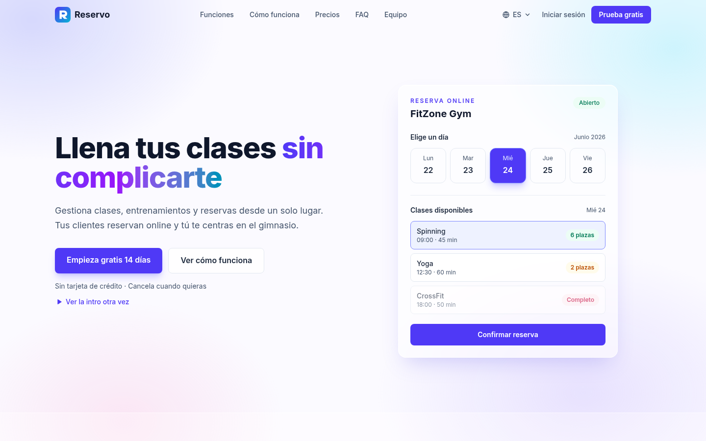
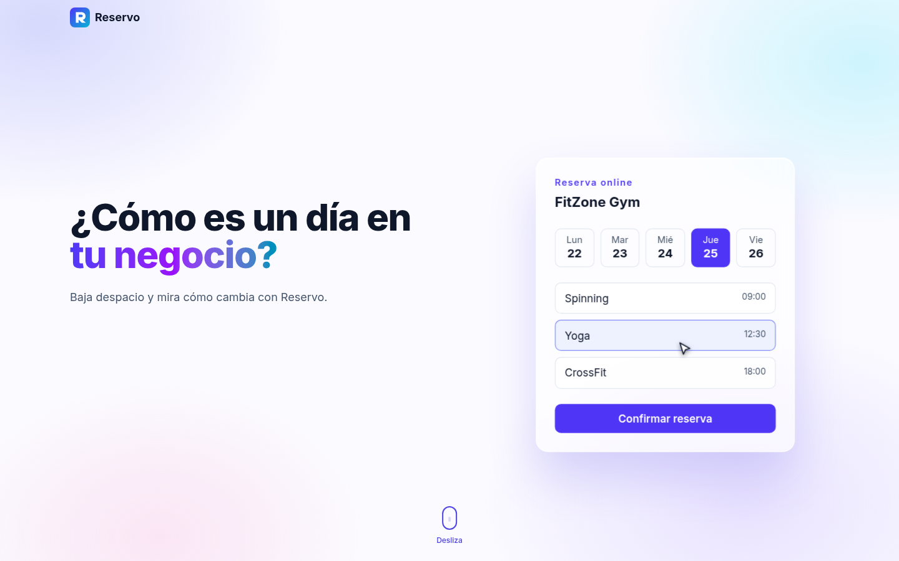
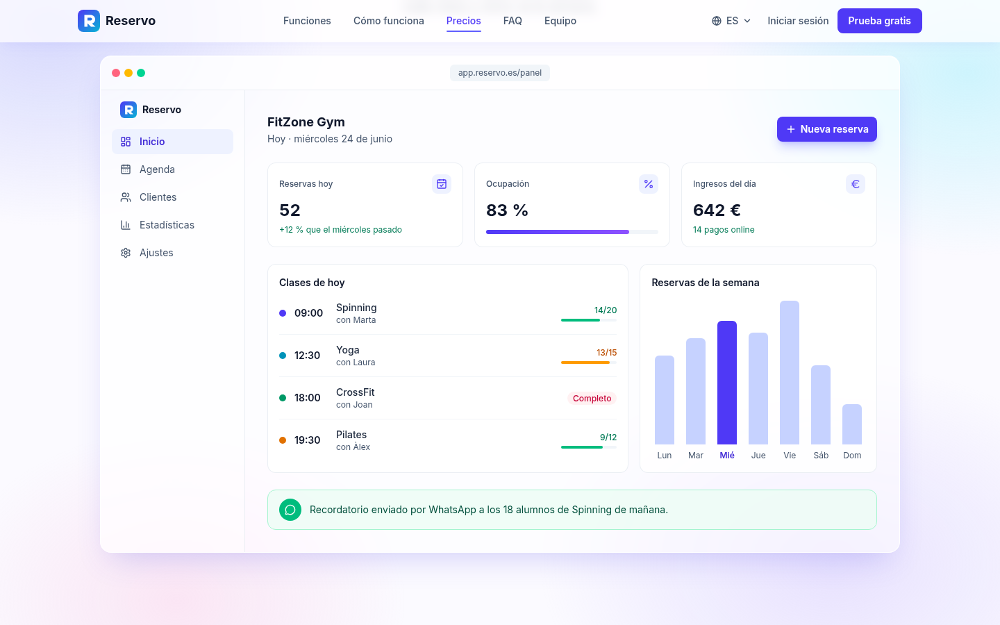
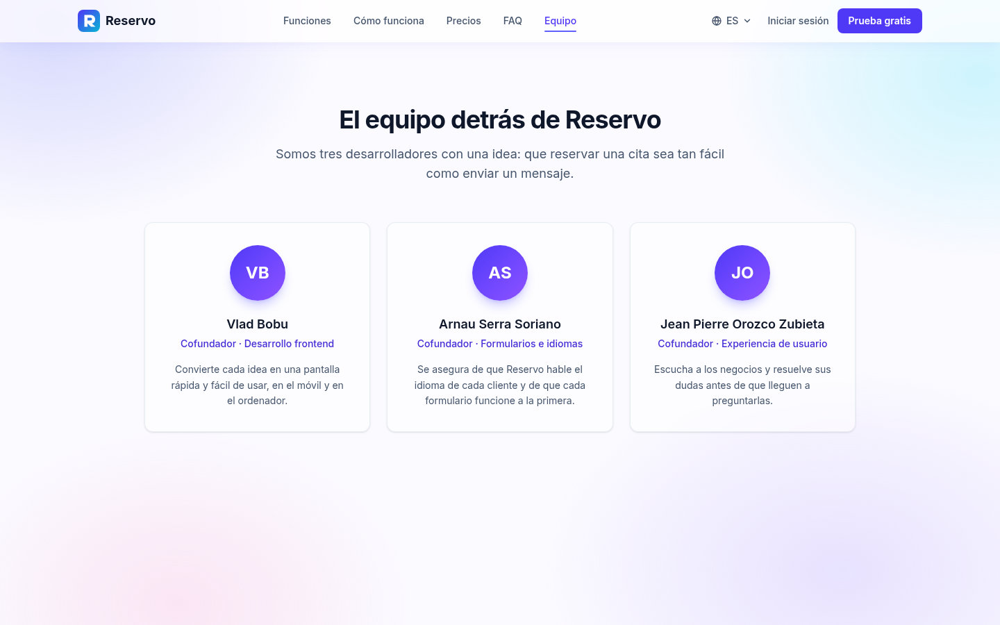
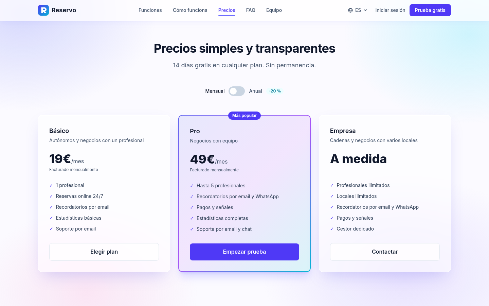
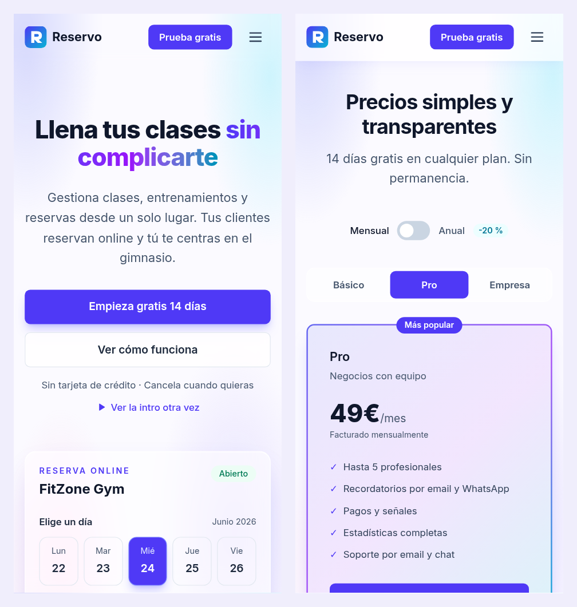

# Grupo-3

## Reservo · Landing page

Landing page de un SaaS ficticio de **reservas online** para negocios con citas: gimnasios, restaurantes, peluquerías y clínicas.

Proyecto hecho con **Vite**, **JavaScript vanilla** y **Tailwind CSS v4**, organizado en componentes. La web está en castellano, inglés y catalán.

Web publicada: <https://2dam-202627-projecte.github.io/Grupo-3/>

## Capturas de la versión final

| Escritorio | Intro «Un día con Reservo» |
|---|---|
|  |  |

| Panel de la app | Equipo |
|---|---|
|  |  |

| Precios (escritorio) | Móvil: inicio y precios |
|---|---|
|  |  |

## Tecnologías

| Herramienta | Versión | Uso |
|---|---|---|
| [Vite](https://vite.dev/) | 8 | Servidor de desarrollo y build (multipágina) |
| [Tailwind CSS](https://tailwindcss.com/) | 4 | Estilos con clases de utilidad (vía `@tailwindcss/vite`) |
| JavaScript | ES Modules | Componentes e interactividad, sin frameworks |
| [GSAP](https://gsap.com/) + ScrollTrigger | 3 | Animaciones de la intro que avanzan con el scroll |
| [Lenis](https://lenis.darkroom.engineering/) | 1 | Scroll suave, con inercia, en la intro |
| [Lucide](https://lucide.dev/) | 1 | Iconos SVG de las funcionalidades |
| [@fontsource-variable/inter](https://fontsource.org/fonts/inter) | 5 | Letra de toda la web, servida desde la propia web (sin Google Fonts) |
| [@fontsource-variable/caveat](https://fontsource.org/fonts/caveat) | 5 | Letra manuscrita de la agenda de papel de la intro |

## Instalación y uso

Necesitas [Git](https://git-scm.com/) y [Node.js](https://nodejs.org/) 20.19 o superior (Vite 8 no funciona con versiones anteriores). Los comandos se ejecutan dentro de la carpeta `proyectoReservo/`:

```bash
git clone https://github.com/2DAM-202627-PROJECTE/Grupo-3.git
cd Grupo-3/proyectoReservo
npm install      # instala las dependencias
npm run dev      # servidor de desarrollo (http://localhost:5173)
npm run build    # genera la versión de producción en dist/
npm run preview  # previsualiza la versión de producción
```

Al subir cambios a `main`, el workflow `deploy.yml` publica la web en GitHub Pages:
<https://2dam-202627-projecte.github.io/Grupo-3/>

## Estructura del proyecto

```
Grupo-3/
├── .github/workflows/
│   └── deploy.yml                # Publica la web en GitHub Pages al subir a main
├── Docs/
│   ├── Documentació de planificació i disseny-2.pdf   # Documento de planificación y diseño
│   ├── Reservo - Seguimiento del proyecto (tablero Kanban).pdf   # Seguimiento en GitHub Project
│   ├── Reservo - Documentación técnica.pdf                       # Documentación técnica del sitio
│   ├── capturas/                 # Capturas de la versión final (las de este README)
│   ├── kanban/                   # Capturas del tablero Kanban
│   └── mockups/                  # Wireframes y mockups (escritorio y móvil)
├── proyectoReservo/              # Proyecto de Vite (aquí se ejecutan los comandos npm)
│   ├── public/
│   │   └── favicon.svg           # Icono de la pestaña
│   ├── src/
│   │   ├── components/
│   │   │   ├── Navbar.js         # Barra de navegación, menú móvil y selector de idioma
│   │   │   ├── Hero.js           # Sección principal con tarjeta de reserva de ejemplo
│   │   │   ├── Sectors.js        # Selector de sector que cambia el Hero
│   │   │   ├── Features.js       # Cuadrícula de funcionalidades
│   │   │   ├── HowItWorks.js     # Cómo funciona en 3 pasos
│   │   │   ├── AppPreview.js     # Vista previa del panel de la app (HTML, sin imágenes)
│   │   │   ├── Pricing.js        # Planes y precios (mensual / anual)
│   │   │   ├── Testimonials.js   # Opiniones de clientes (carrusel en móvil)
│   │   │   ├── Faq.js            # Preguntas frecuentes (desplegables)
│   │   │   ├── Team.js           # Equipo de Reservo (los tres integrantes)
│   │   │   ├── Cta.js            # Formulario de prueba gratuita
│   │   │   ├── Footer.js         # Pie de página
│   │   │   ├── Newsletter.js     # Suscripción a la newsletter con Mailchimp (dentro del footer)
│   │   │   └── PreferencesBar.js # Aviso de cookies de la primera visita
│   │   ├── intro/
│   │   │   ├── Intro.js          # Intro animada "Un día con Reservo" (solo la primera vez)
│   │   │   └── intro.css         # Estilos de la intro
│   │   ├── locales/
│   │   │   ├── es.js             # Textos en castellano
│   │   │   ├── en.js             # Textos en inglés
│   │   │   └── ca.js             # Textos en catalán
│   │   ├── main.js               # Punto de entrada: crea las secciones y pinta los componentes
│   │   ├── cookiesPage.js        # Punto de entrada de la política de cookies (la traduce)
│   │   ├── legalNoticePage.js    # Punto de entrada del aviso legal (lo traduce)
│   │   ├── privacyPage.js        # Punto de entrada de la política de privacidad (la traduce)
│   │   ├── i18n.js               # Traducción: idioma del navegador o el elegido, t(clave)
│   │   ├── scrollReveal.js       # Animación de las secciones al hacer scroll
│   │   └── style.css             # Tailwind v4, variables del tema claro y estilos comunes
│   ├── index.html                # Landing: HTML base con <div id="app">
│   ├── aviso-legal.html          # Página legal: aviso legal (LSSI-CE)
│   ├── LICENSE                   # Licencia del proyecto
│   ├── politica-cookies.html     # Página legal: política de cookies
│   ├── politica-privacidad.html  # Página legal: política de privacidad (RGPD)
│   ├── package.json              # Dependencias y scripts
│   └── vite.config.js            # Vite + Tailwind, base /Grupo-3/ y build multipágina
└── README.md
```

## Flujo de trabajo con Git

**Ramas**

- `main`: versión estable. Cada cambio que llega a `main` se publica en GitHub Pages.
- Una rama por integrante: `Landing-Page-Vlad`, `landing-page-arnau` y `landing-page-Jean`. Cada uno trabaja en los componentes que tiene asignados en el tablero Kanban.

**Integración en `main`**

- Las ramas se integran en `main` con frecuencia, varias veces en cada sprint.
- Las ramas `landing-page-arnau` y `landing-page-Jean` llegan como *pull request*. Se revisan y se fusionan con un *merge commit*, que conserva la autoría de los commits. Si hay que corregir algo, se hace en un commit aparte.
- `Landing-Page-Vlad` se lleva a `main` directamente, sin *merge commit*, cuando sus cambios están comprobados.
- Antes de subir a `main` se comprueba que `npm run build` funciona y que la consola no da errores.

**Commits**

- Pequeños y de un solo cambio.
- El mensaje empieza por la sección o el archivo que cambia y termina con el número del issue, para que GitHub lo enlace con la tarea del tablero:

```
Precios: pestañas de los planes en móvil #20
```

**Conflictos**

Antes de abrir un *pull request* se trae `main` a la propia rama (`git merge main`) y los conflictos se resuelven ahí, sin tocar `main`.

## Secciones de la página

0. **Intro "Un día con Reservo"**: animación que avanza con el scroll y cuenta el antes y el después de usar Reservo. Solo sale en la primera visita; después se entra directamente en la landing.
1. **Navbar**: logo, enlaces a las secciones, selector de idioma y botones "Iniciar sesión" y "Prueba gratis". Se queda fija arriba y marca la sección que se está viendo. En móvil se convierte en un menú desplegable.
2. **Hero**: titular principal, botones de acción y una tarjeta que simula la app reservando una cita.
3. **Sectors**: selector de los cuatro tipos de negocio (gimnasio, restaurante, peluquería y clínica). Al elegir uno, cambia la tarjeta del Hero.
4. **Features**: seis funcionalidades (reservas 24/7, recordatorios, pagos, equipo, estadísticas, app móvil).
5. **How it works**: los tres pasos para empezar.
6. **App preview**: así se ve Reservo por dentro. Un panel de ejemplo de FitZone Gym (cifras del día, agenda de clases con su ocupación, reservas de la semana y un recordatorio de WhatsApp), hecho con HTML y Tailwind en vez de con una imagen: se ve nítido en cualquier pantalla, se traduce y no pesa.
7. **Testimonials**: tres opiniones de clientes de sectores distintos. Van antes de los precios para dar confianza antes de ver cuánto cuesta. En móvil se ven de una en una, en un carrusel con flechas y puntos.
8. **Pricing**: tres planes (Básico 19 €, Pro 49 € destacado, Empresa a medida) con interruptor mensual / anual (20 % de descuento). En móvil, los planes se ven de uno en uno con pestañas.
9. **FAQ**: preguntas frecuentes, que se abren y cierran sin JavaScript.
10. **Team**: el equipo que hay detrás de Reservo (Vlad, Arnau y Jean), con avatar de iniciales, rol y una frase. Va antes del CTA para dar confianza antes de registrarse.
11. **CTA**: formulario para dejar el email y empezar la prueba gratuita de 14 días, con validación y mensaje de confirmación.
12. **Footer**: logo, suscripción a la newsletter (Mailchimp, con email de confirmación y enlace a la política de privacidad), enlaces legales, contacto por email, redes sociales (se abren en una pestaña nueva) y copyright con el año actual.

Además, en la primera visita sale un **aviso de cookies** abajo de la pantalla. La elección se guarda y el aviso ya no vuelve a salir. Los textos legales tienen su propia página, enlazada desde el footer: aviso legal (`aviso-legal.html`), política de privacidad (`politica-privacidad.html`) y política de cookies (`politica-cookies.html`). Reservo es ficticio, así que los datos de la empresa son inventados y las páginas lo indican.

Toda la web, incluidas las páginas legales, está en **castellano, inglés y catalán**. La primera vez se muestra en el idioma del navegador; el idioma elegido en el menú se guarda para las siguientes visitas. Los textos están en `src/locales/`.
